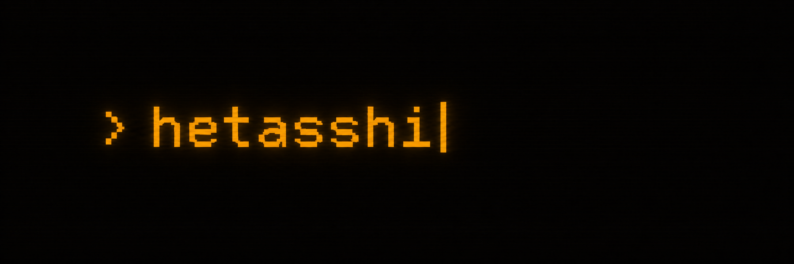

  <picture>
    
  </picture>

### Software Developer & Designer | _Desktop, Web & Backend_

I build **Windows and Linux desktop applications**, **web interfaces**, and **backend services**. I design <ins>software architecture</ins>, *develop and train AI models*, and *reverse-engineer software*.

<picture>
  
</picture>

`Rust` · `C++` · `C` · `Zig` · `Go` · `C#` · `Python` · `Java` · `TypeScript` · `JavaScript` · `React` · `Node.js` · `Tauri` · `PostgreSQL` · `WebSocket` · `Docker` · etc.

  <picture>
    
  </picture>

